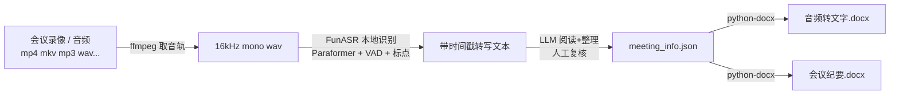

# video2minutes

**一段会议录像 → 两份可直接归档的 Word 文档，全程本地离线，数据不出你的电脑。**

把 253MB 的会议屏幕录像丢给它，35 分钟后你拿到：

- 📄 **音频转文字稿**（带时间戳分段，可检索定位到每句话）
- 📋 **会议纪要**（概况 / 讨论要点 / 待确认事项 / 下一步分工，公文排版）

不调云端 API、不上传音频、不花一分钱。识别用的是阿里达摩院开源的 Paraformer，纪要排版由结构化 JSON 驱动，格式完全可控。



## 为什么不用讯飞/通义/Whisper API？

| | 云端转写 API | video2minutes |
|---|---|---|
| 音频去向 | 上传到厂商服务器 | **永远留在本机** |
| 费用 | 按时长计费 | **0 元**（CPU 跑） |
| 内网/保密会议 | 基本没戏 | 随便开 |
| 纪要格式 | 模板固定 | **JSON 定义，想怎么排就怎么排** |
| 中文识别 | 好 | 好（Paraformer-large，中文榜第一梯队） |

适用场景：保密会议、内网环境、不想把录音交给第三方、批量处理、学生党不想付 API 费。

## 快速开始

```bash
# 1. 装依赖（Python 3.10+，另需 ffmpeg 在 PATH 中）
pip install -r requirements.txt

# 2. 离线转写（首次运行自动下载模型约 1GB，之后离线可用）
python scripts/transcribe.py 你的会议录像.mp4 -o _transcribe
#    -> _transcribe/transcript_ts.txt   带时间戳的转写文本
#    -> _transcribe/transcript.json     带句子级时间戳的原始结果

# 3. 复制 docs/meeting_info.example.json 为 meeting_info.json，
#    让 LLM 通读 transcript_ts.txt 后按 schema 填写，人工复核一遍

# 4. 生成两份 Word
python scripts/build_minutes.py meeting_info.json --ts _transcribe/transcript_ts.txt -o .
#    -> XX会议-音频转文字.docx
#    -> XX会议-会议纪要.docx
```

**速度参考**：纯 CPU 约「音频时长 ÷ 8」（38 分钟音频 ≈ 9 分钟，i7 笔记本）。有 NVIDIA 显卡把 `device` 改成 `cuda` 能快数倍。中断后重跑会跳过已解码的 wav，不浪费前功。

## 实测效果

- 253MB 屏幕录像（38 分钟，含电话接入、远场拾音）→ 有效转写 35 分钟（自动滤除末尾静默段的孤立标点）
- 转写稿自带**高频误识对照表**（如「网们平台→网平台」），LLM 整理时自动发现，人工核对效率高很多

## 纪要格式由 JSON 完全定义

`meeting_info.json` 里的每个块都是显式声明的，LLM 只负责「填内容」，排版交给代码：

| 块类型 | 作用 |
|---|---|
| `h1` / `h2` | 标题 |
| `p` | 段落 |
| `kv` | 两列键值表（会议名称/时间/地点…） |
| `table` | 普通表格，支持列对齐 |
| `num` | 编号列表 |
| `note` | 带边框的说明段（免责/备注） |
| `sign` | 右对齐落款 |

改字体、改边距、加红头——直接改 `build_minutes.py`，一处改完所有会议生效。完整字段见 [docs/meeting_info.example.json](docs/meeting_info.example.json)。

## 踩坑记录（帮你省一个下午）

1. **Windows 模型缓存必须用短路径**（如 `~/v2m_cache`）。ModelScope 快照目录名极长，缓存放深目录会撞 260 字符上限，报 `WinError 206`，模型下载全线失败。
2. **装了 funasr 还不够**，缺 `kaldi-native-fbank` 会报 `torchaudio is not installed and neither is the kaldi-native-fbank fallback backend`（requirements.txt 已包含）。
3. **转写日志重定向到文件再看**，否则 tqdm 进度条会刷出几万字符。
4. 转写结果仅供检索参考：远场拾音、电话接入场景有同音字误差，重要纪要务必人工复核关键结论。

## 项目结构

```
video2minutes/
├── scripts/
│   ├── transcribe.py      # Step 1: 视频/音频 -> 离线转写（时间戳分段）
│   └── build_minutes.py   # Step 2: 结构化 JSON -> 两份 Word
├── docs/
│   └── meeting_info.example.json   # 纪要 schema 示例（脱敏）
└── requirements.txt
```

## License

MIT © [Non-existent987](https://github.com/Non-existent987)
